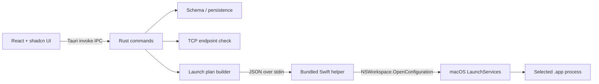

# Architecture and security notes

## Ownership

- **React:** edit and inspect saved state, keyboard navigation, error/empty/loading states; cannot run arbitrary system commands.
- **Rust:** validates paths, hostnames, ports and profile associations; performs atomic local JSON persistence and TCP reachability; builds explicit env/argv structures.
- **Swift helper:** small non-sandboxed AppKit executable compiled locally with `xcrun swiftc` and bundled as a resource; accepts only the validated launch plan on stdin; checks running bundle ID; calls `NSWorkspace.shared.openApplication(at:configuration:completionHandler:)` and replies with PID or explicit error.
- **Proxy client:** external dependency owned by user; LaunchAnything never starts, stops or replaces it.

## Trust boundaries

| Boundary | Protection |
|---|---|
| Browser/WebView → native | Explicit, small Tauri command list; no shell plugin or arbitrary filesystem API. |
| Editable config → OS process | Validate absolute `.app` path, canonicalize, serialize JSON; no shell expansions. |
| App starts → routing claims | Report PID and launch confirmation only. Do not claim proxy enforcement. |
| Frontend → persisted file | Rust owns the state lock, schema version and atomic replacement. |
| Proxy connectivity → routing | Reachability is TCP-only. App may still bypass the endpoint. |

### Distribution note

Do not enable App Sandbox: Apple explicitly ignores `NSWorkspace.OpenConfiguration.environment` for sandboxed callers. The helper should be shipped inside the signed app bundle; notarization and hardened runtime compatibility should be validated as a separate release task before public distribution. This app does not install a privileged daemon and does not modify `/etc`, network interfaces or global proxy settings.

### Data file

`app.path().app_config_dir()/state.json`, platform-selected user app config directory. No secrets are stored. Unknown schema versions fail without migration, preserving the original bytes. All writes are synchronized behind a process-local mutex.
